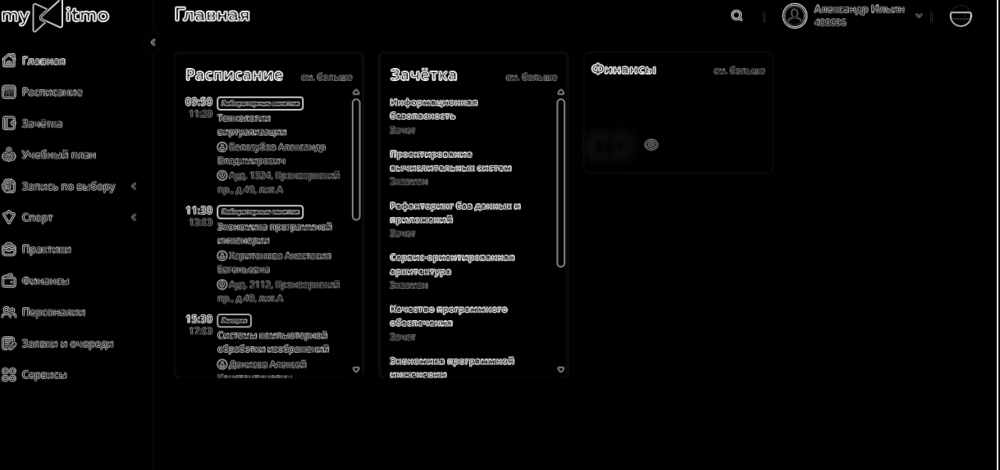
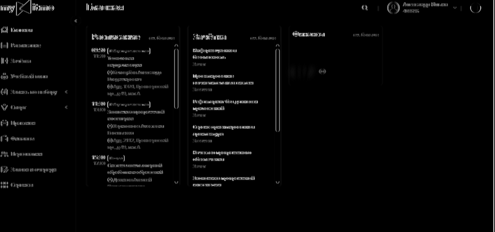
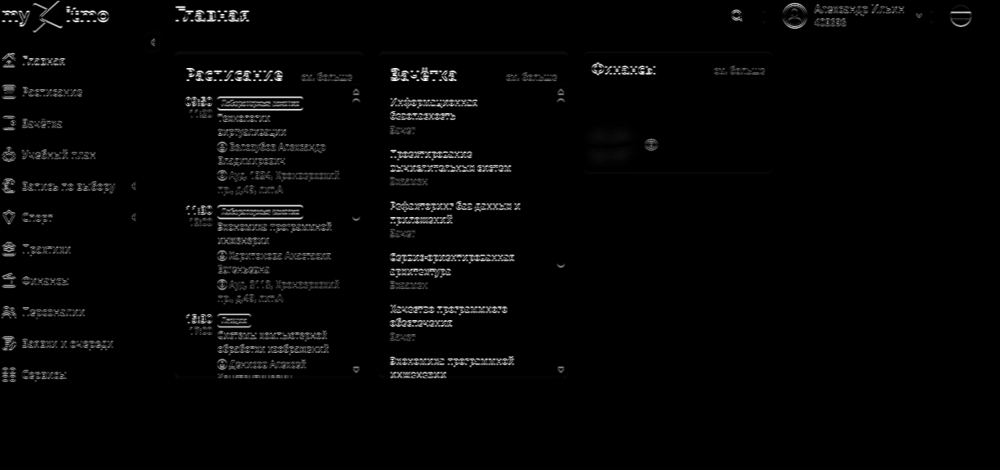
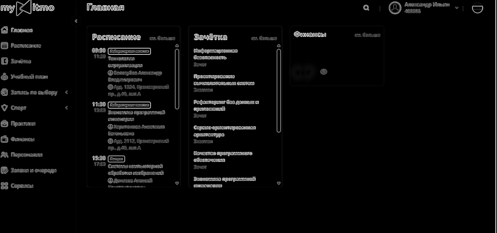
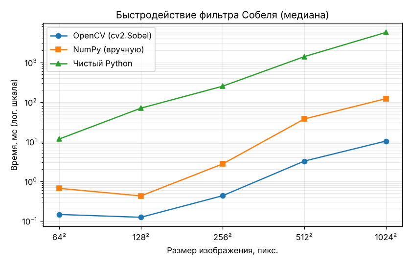

# ЛР1. Вариант 1: фильтр Собеля

Программа выделяет границы на изображении фильтром Собеля. Один и тот же алгоритм реализован двумя способами: встроенной функцией OpenCV `cv2.Sobel` и вручную на чистом Python. Для сравнения добавлена третья, ручная векторизованная версия на NumPy. Для загрузки и сохранения изображений во всех случаях используется OpenCV.

## Запуск

Требуется Python 3.10 или новее. Из папки проекта:

```bash
python -m pip install -r requirements.txt
python main.py images/input.png --repeats 5
python benchmark.py
python -m unittest -v
```

Всё сразу (обработка, замер времени, тесты и открытие результатов): `python run_all.py`.

`main.py` сохраняет результаты в папку `output/`: исходное изображение в оттенках серого, |Gx|, |Gy| и модуль градиента для обеих реализаций. Вместо `images/input.png` можно указать собственное изображение, цветное изображение приводится к оттенкам серого. Параметр `--output-dir` задаёт другую папку для результатов, `--repeats` — число запусков каждой реализации при измерении времени. Программа выводит медианное время, ускорение и наибольшее расхождение между результатами.

`benchmark.py` замеряет время на изображениях 64×64 … 1024×1024 и сохраняет таблицу, график и примеры в папку `examples/`.

## 1. Теоретическая база

Фильтр Собеля — дискретный дифференциальный оператор, который приближённо вычисляет градиент яркости изображения. На границах объектов яркость меняется резко, поэтому модуль градиента там большой, а на однородных участках близок к нулю.

Градиент вычисляется свёрткой изображения `A` с двумя ядрами 3 × 3:

```
      | -1  0  +1 |            | -1  -2  -1 |
Gx =  | -2  0  +2 | * A   Gy = |  0   0   0 | * A
      | -1  0  +1 |            | +1  +2  +1 |
```

`Gx` реагирует на изменение яркости по горизонтали, то есть на вертикальные границы. `Gy` реагирует на изменение по вертикали, то есть на горизонтальные границы. Результат — модуль градиента `G = √(Gx² + Gy²)`, направление границы можно найти как `θ = atan2(Gy, Gx)`.

Ядро разделимо: `Gx = [1 2 1]ᵀ · [-1 0 1]`. Это сглаживание по одной оси и разностная производная по другой, поэтому фильтр Собеля менее чувствителен к шуму, чем простая разность соседних пикселей. Сумма элементов каждого ядра равна нулю, поэтому на одноцветной области результат равен нулю.

Для пикселей у края окно 3 × 3 выходит за пределы изображения. Здесь, как и по умолчанию в OpenCV, используется отражение без повтора крайнего пикселя (`BORDER_REFLECT_101`): за пикселями `a b c` слева идут `… c b`. Для изображения шириной `W` и высотой `H` требуется порядка `O(W·H·9)` операций.

## 2. Разработанная система

| Файл | Назначение |
| --- | --- |
| `sobel.py` | Ядра фильтра и три реализации алгоритма |
| `main.py` | Обработка одного изображения, сравнение и замер времени |
| `benchmark.py` | Замер времени на разных размерах, график и примеры |
| `test_sobel.py` | Модульные тесты |
| `run_all.py` | Полная демонстрация: все шаги по очереди |
| `install_requirements.py` | Установка зависимостей из `requirements.txt` в текущий интерпретатор |

### `sobel_opencv`: библиотечная обработка

Производные по x и y вычисляются готовой функцией `cv2.Sobel` с ядром 3 × 3 и типом результата `CV_64F`, чтобы не терять отрицательные значения. Модуль градиента вычисляет `cv2.magnitude`.

```python
gx = cv2.Sobel(gray, cv2.CV_64F, 1, 0, ksize=3)
gy = cv2.Sobel(gray, cv2.CV_64F, 0, 1, ksize=3)
mag = cv2.magnitude(gx, gy)
```

### `sobel_native`: ручная обработка

Изображение переводится в список списков, и свёртка выполняется вложенными циклами. Для каждой строки берутся три соседние строки, для каждого пикселя — три соседних столбца. Функция `_reflect101` отражает индексы, вышедшие за границу. Затем перебираются девять элементов окна, их значения умножаются на веса ядер `KX` и `KY` и суммируются.

```python
def _reflect101(i, n):
    if i < 0:
        return -i
    if i >= n:
        return 2 * n - i - 2
    return i
```

```python
for y in range(h):
    rows = [img[_reflect101(y + dy, h)] for dy in (-1, 0, 1)]
    for x in range(w):
        cols = [_reflect101(x + dx, w) for dx in (-1, 0, 1)]
        sx = sy = 0.0
        for ky in range(3):
            for kx in range(3):
                p = rows[ky][cols[kx]]
                sx += KX[ky][kx] * p
                sy += KY[ky][kx] * p
        mag[y][x] = math.sqrt(sx * sx + sy * sy)
```

### `sobel_numpy`: ручная векторизованная обработка

Готовая функция фильтра не используется. Изображение дополняется на один пиксель отражением (`mode="reflect"` в NumPy соответствует `BORDER_REFLECT_101`), затем девять сдвинутых копий массива складываются с весами ядра.

```python
a = np.pad(gray.astype(np.float64), 1, mode="reflect")
for ky in range(3):
    for kx in range(3):
        win = a[ky:ky + h, kx:kx + w]
        gx += KX[ky][kx] * win
        gy += KY[ky][kx] * win
```

### `measure` и `main`: сравнение результатов

`measure` запускает переданную функцию несколько раз и возвращает результат последнего запуска и медианное время.

```python
def measure(function, repeats):
    times = []
    result = None
    for _ in range(repeats):
        start = time.perf_counter()
        result = function()
        times.append(time.perf_counter() - start)
    return result, statistics.median(times)
```

`main` вызывает `measure` для обеих реализаций, сохраняет изображения, сравнивает модули градиента по пикселям и выводит время и ускорение. Чтение и запись файлов в замеры не входят: сравнивается только работа фильтра. Для сохранения модуль градиента нормируется в диапазон 0…255 функцией `to_uint8`.

## 3. Результаты и тестирования

В качестве тестового использован скриншот главной страницы my.itmo размером 1219 × 574 пикселей, приведённый к оттенкам серого. На нём много текста, иконок и рамок, то есть резких перепадов яркости на однородном фоне.

| Исходное изображение | Модуль градиента, OpenCV |
| --- | --- |
|  |  |
| **\|Gx\| — вертикальные границы** | **\|Gy\| — горизонтальные границы** |
|  |  |

Результат ручной реализации:



Однородный фон после фильтра становится чёрным: градиент там равен нулю. Буквы, иконки, рамки карточек и полосы прокрутки превращаются в светлые контуры. На |Gx| ярче всего вертикальные элементы: полосы прокрутки, боковые стороны карточек, вертикальные штрихи букв. На |Gy| ярче горизонтальные: верхние и нижние края карточек, горизонтальные штрихи букв. Изображения OpenCV и ручной реализации совпадают побайтно.

Время — медиана нескольких запусков (OpenCV — 51, NumPy — 11, Python — 3–5). Замеры выполнены на ноутбуке под Windows, Python 3.11. Использовано то же изображение, приведённое к квадратному размеру.

| Размер | OpenCV, мс | NumPy, мс | Python, мс | Ускорение OpenCV относительно Python | Максимальная разница |
| --- | ---: | ---: | ---: | ---: | ---: |
| 64 × 64 | 0.146 | 0.664 | 11.7 | 80 раз | 0 |
| 128 × 128 | 0.124 | 0.428 | 70.0 | 567 раз | 0 |
| 256 × 256 | 0.432 | 2.734 | 250.2 | 579 раз | 0 |
| 512 × 512 | 3.226 | 37.261 | 1395.8 | 433 раза | 0 |
| 1024 × 1024 | 10.347 | 121.519 | 5707.1 | 552 раза | 0 |



Результаты всех трёх реализаций совпали на каждом размере, максимальная разница модуля градиента равна нулю. Время зависит от компьютера и его нагрузки; для сравнения на другом компьютере следует повторить замеры.

Закономерности:

- время всех реализаций растёт пропорционально числу пикселей: при увеличении стороны вдвое время растёт примерно в 4 раза;
- чистый Python медленнее OpenCV в 430–580 раз, потому что интерпретатор выполняет каждую операцию над каждым пикселем отдельно. На изображении 64 × 64 разница меньше (80 раз): время OpenCV там почти целиком занимают накладные расходы вызова функции;
- версия на NumPy медленнее OpenCV в 3.5–12 раз, но быстрее чистого Python в 20–160 раз: циклы выполняются в скомпилированном коде, но на каждом из девяти сдвигов создаются временные массивы;
- OpenCV быстрее всех благодаря оптимизированному коду на C++, SIMD-инструкциям, разделимой свёртке и многопоточности.

Проверка `python -m unittest -v` включает шесть тестов: нулевую сумму ядер и их транспонированность, отражение индексов, нулевой градиент на одноцветном изображении, правильный отклик на вертикальную границу, совпадение трёх реализаций со `cv2.Sobel` на случайных изображениях разного размера и на реальном изображении. Все шесть тестов прошли.

## 4. Выводы

Обе реализации дают одинаковые результаты при одинаковой обработке краёв: на всех размерах изображения разница равна нулю. Фильтр корректно выделяет границы объектов: `Gx` реагирует на вертикальные перепады яркости, `Gy` — на горизонтальные. Встроенная функция OpenCV обработала изображения в 430–580 раз быстрее ручной реализации на Python, поэтому для практических задач следует использовать оптимизированные библиотеки. Если готовой функции нет, значительного ускорения можно добиться векторизацией на NumPy.

## 5. Использованные источники

1. Техническое задание «ЛР1», файл `LW1.pdf`, предоставленный для этой работы.
2. [OpenCV: Sobel Derivatives](https://docs.opencv.org/4.x/d2/d2c/tutorial_sobel_derivatives.html).
3. [OpenCV: функции фильтрации изображений и типы границ](https://docs.opencv.org/4.x/d4/d86/group__imgproc__filter.html).
4. [NumPy: `pad`](https://numpy.org/doc/stable/reference/generated/numpy.pad.html).
5. Гонсалес Р., Вудс Р. Цифровая обработка изображений. — М.: Техносфера, 2012.
